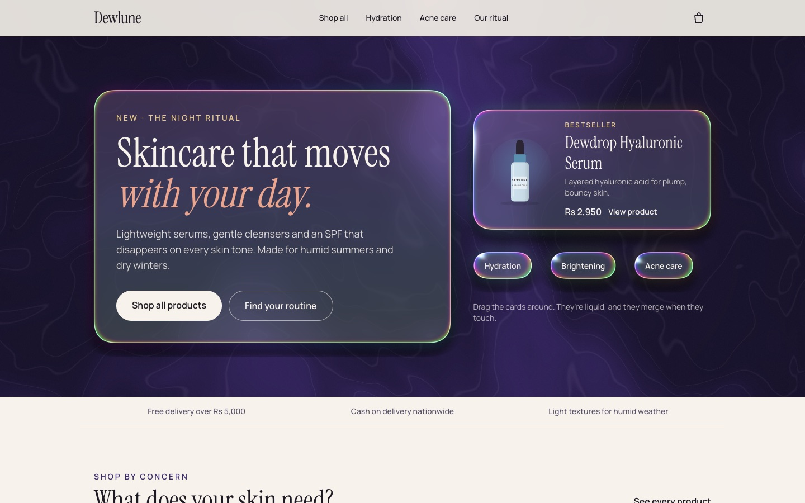
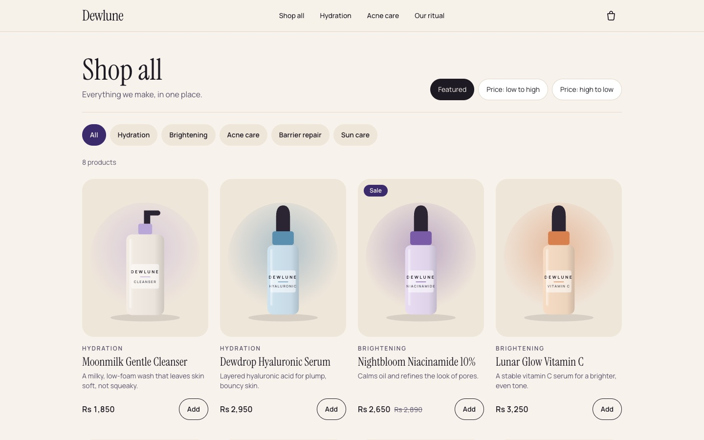
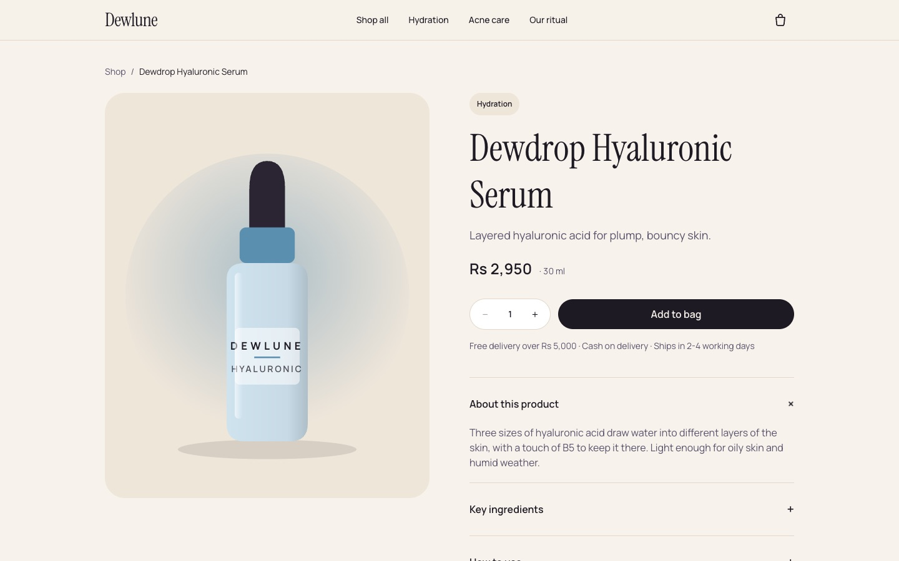

# Dewlune: a headless WooCommerce skincare store

A skincare storefront built with **Next.js 16**, **Plasma UI** liquid-glass components and a **headless WooCommerce** backend. Products, cart and checkout come from WordPress through the WooCommerce Store API, while the shopping experience is a fast React front end.

Dewlune is a fictional brand made for my portfolio. No real orders are shipped.



| Shop | Product | Mobile |
|---|---|---|
|  |  |  |

## What it does

- **Catalog from WooCommerce:** products, prices, sale prices, categories, attributes (size, key ingredients, how to use) and images are read from the Store API.
- **Real cart and checkout:** add, update and remove items, then place a cash-on-delivery order that lands in WooCommerce admin as a normal order.
- **Liquid hero:** the home page panels are rendered in WebGL with [Plasma UI](https://github.com/cruxgarden/plasma-ui). They refract the background, can be dragged, and merge when they touch.
- **Shop by concern:** filter by hydration, brightening, acne care and more, and sort by price.
- **Free-delivery meter:** the bag shows how far you are from free delivery (Rs 5,000). WooCommerce is configured with the same rule.
- **Demo mode:** with no backend configured, the store runs on bundled demo data, so it can be deployed anywhere for free.

## How it works

```
Browser ──► Next.js (App Router, Cache Components)
              ├─ pages: catalog fetched with "use cache", prerendered, revalidated every minute
              ├─ /api/cart, /api/checkout: server routes that call the Store API
              │     └─ keeps WooCommerce's Cart-Token in an httpOnly cookie
              └─ Plasma UI hero: loaded only on desktop, unloaded when scrolled away
                        │
                        ▼
            WordPress + WooCommerce (Docker)
              ├─ Store API: products, cart, checkout
              ├─ seed.php: settings, cash on delivery, shipping zone, catalog
              └─ mu-plugins/dewlune-checkout.php: Pakistani address rules
```

### Decisions worth mentioning

- **The browser never talks to WordPress.** Cart calls go through Next.js route handlers, which keep the guest Cart-Token in an httpOnly cookie. No CORS setup and no token in JavaScript.
- **Plasma UI only where it makes sense.** The library draws a full-screen WebGL canvas and is heavy on phones. The hero loads it only on desktop with a mouse and WebGL2, unmounts it once the hero scrolls out of view, and shows CSS frosted glass everywhere else. Phones never download the Plasma code.
- **Address rules live in WordPress.** WooCommerce requires a postal code for Pakistan by default. A small must-use plugin makes it optional and labels the state field "Province". The Store API validates against these rules, so the headless checkout and the classic checkout always agree.
- **Accessibility:** keyboard-friendly bag drawer (native `<dialog>`), skip link, visible focus, an error summary on checkout that links to each field, and 44px touch targets.

## Tech stack

Next.js 16 (App Router, Cache Components) · React 19 · TypeScript · Tailwind CSS 4 · Plasma UI · WordPress 7 · WooCommerce Store API · PHP · Docker

## Run it locally

**Demo mode** (no backend needed):

```bash
cd web
npm install
npm run dev
```

Open http://localhost:3000.

**With WooCommerce** (needs Docker):

```bash
./wordpress/setup.sh
cp web/.env.example web/.env.local
cd web && npm run dev
```

`setup.sh` starts WordPress on http://localhost:8080, installs WooCommerce, and seeds settings, delivery rules and the 8 products. The WordPress admin password is generated into `wordpress/.env`. Running it again is safe.

## Project structure

```
web/                      Next.js storefront
  src/app/                pages, plus /api/cart and /api/checkout
  src/components/         product cards, bag drawer, liquid hero
  src/lib/catalog/        WooCommerce adapter and demo catalog
  src/lib/woo-cart.ts     Store API cart and checkout bridge
  src/data/catalog.json   product data, shared with the WordPress seeder
wordpress/                Docker setup for WordPress + WooCommerce
  seed/seed.php           store settings and catalog seeding (WP-CLI)
  mu-plugins/             custom checkout rules
docs/                     screenshots
```

## Credits

Liquid components by [Plasma UI](https://github.com/cruxgarden/plasma-ui) (MIT). Product illustrations are original SVG drawings made for this project.

Built by **Muneeb Ud Din**: [GitHub](https://github.com/muneebuddinzamir-bit) · [LinkedIn](https://linkedin.com/in/muneeb-ud-din-0258a235)
